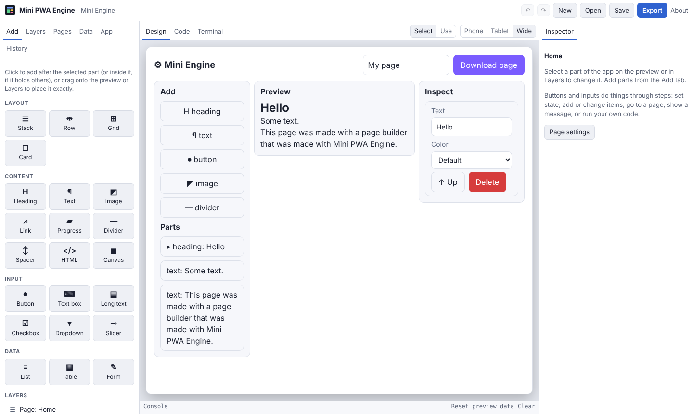

# Tutorial: the engine, made with the engine

Mini PWA Engine is a page builder. This tutorial uses it to build a smaller page builder, **Mini Engine**, out of nothing but the engine's own components and a few lines of custom JavaScript. It has the same shape as the engine you build it in:

| Mini PWA Engine | Mini Engine | Made from |
| --- | --- | --- |
| Add tab (the palette) | **Add** | a List over a data source of part kinds |
| Layers | **Parts** | a List over the page's parts |
| Preview | **Preview** | an HTML component showing generated HTML |
| Inspector | **Inspect** | a List filtered to the selected part, with inputs bound to its fields |
| Code generator, Export | **Download page** | custom JavaScript, like the engine's own `makeGen()` |
| Saving projects | built in | the parts are a data source kept on the device |

The finished app is a starter: **New › Mini Engine**. Open it next to this page to compare, or follow along from a blank project. It takes about twenty minutes.



## 1. Start

1. **New › Blank**.
2. In **App**, set the name to `Mini Engine`, the icon to `⚙`, and **Content width** to `1100` (it is a desktop tool first; it still works on a phone).
3. Delete the starter heading: select it and press Delete.

## 2. The data

Open **Data**.

**State** is what the app remembers while it runs. Add two:

| Name | Type | Start value |
| --- | --- | --- |
| `appName` | Text | `My page` |
| `selected` | Text | *(blank)*: the id of the part being edited |

**Data sources** are lists of items. Add two:

- `kinds`, kept in **Memory**, with fields `kind`, `icon` and `sample` (all Text). This is the palette, so give it sample rows:

  | kind | icon | sample |
  | --- | --- | --- |
  | heading | H | A heading |
  | text | ¶ | Some text. |
  | button | ⏺ | A button |
  | image | ◩ | https://picsum.photos/480/200 |
  | divider | — | |

- `parts`, kept on **This device**, with fields `kind`, `text` and `color` (all Text). These are the page's parts, the mini engine's equivalent of the engine's component tree. Add a sample row or two (`heading` / `Hello`) so the preview has something to show.

## 3. The header

Drag a **Row** from **Add** onto the preview. Inside it (drop onto the middle of the row; a dashed box shows where it will land):

1. A **Heading**: text `⚙ Mini Engine`, size H3. In the Inspector's **Layout** box set **Width: Fill**, so it takes the free space and pushes the rest to the right.
2. A **Text box**: no label, placeholder `Page name`, **Keeps its value in** `appName`. Set **Width: Fixed**, then drag its right-hand handle in the preview to about 180px (sizes snap to 4px; hold Alt for 1px).
3. A **Button**: label `Download page`. Its step comes in section 9.

Select the Row and untick **Wrap onto more lines when narrow**, so the header stays on one line.

## 4. Three panes

Drag another **Row** below the header. Select it, and in **Layout › Children** click the top-left dot of the alignment grid, so the panes line up at their tops.

Put three **Cards** inside it. These are the engine's three panes:

| Card | Layout › Width | Padding |
| --- | --- | --- |
| Left (Add, Parts) | Fixed, 200 | 12 |
| Middle (Preview) | Fill | 12 |
| Right (Inspect) | Fixed, 220 | 12 |

Set padding in the margin-and-padding picture: type `12` in each side of the inner box. Leave the Row's wrapping on: on a phone the cards drop under each other, and a Fill part in a wrapping Row moves to its own line when it would get narrower than 240px. Switch the preview between **Phone** and **Wide** to see it.

## 5. The palette

In the left card:

1. A **Heading** `Add`, size H4.
2. A **List**: **Shows items from** `kinds`, **Each item is a** Stack, tick **Plain items**.
3. Inside the List, a **Button** with label `{{item.icon}}  {{item.kind}}`, style Outlined. `{{ }}` shows a value; inside a List, `item` is the row being drawn.
4. With the Button selected, under **When clicked** add a step **Add an item**: to `parts`, with `kind` = `item.kind`, `text` = `item.sample`, `color` = `''`.

Each click now adds a part. Try it in **Use** mode.

## 6. The parts list (Layers)

Still in the left card, below the palette:

1. A **Heading** `Parts`, H4.
2. A **List** from `parts`, with a **Text** inside: `{{item.id === selected ? "▸ " : ""}}{{item.kind}}: {{item.text}}`.
3. Select the List and under **When an item is clicked** add **Set state** `selected` to `item.id`.

The arrow marks the selected part, like the highlight in Layers.

## 7. The code generator

The real engine turns its component tree into code with JavaScript (`makeGen()` in `index.html`). The mini engine does the same, much smaller. Open **App › Custom JavaScript** and paste:

```js
// The mini engine's code generator: it turns the parts into HTML. The preview
// (an HTML component showing {{ preview(parts) }}) and the download both use it.
const esc = s => String(s ?? '').replace(/[&<>"]/g, c => ({ '&': '&amp;', '<': '&lt;', '>': '&gt;', '"': '&quot;' }[c]));

function partHtml(part) {
  const style = part.color ? ` style="color: ${esc(part.color)}"` : '';
  if (part.kind === 'heading') return `<h2${style}>${esc(part.text)}</h2>`;
  if (part.kind === 'button') return `<button${style}>${esc(part.text)}</button>`;
  if (part.kind === 'image') return ``;
  if (part.kind === 'divider') return '<hr>';
  return `<p${style}>${esc(part.text)}</p>`;
}

function preview(parts) {
  return parts.map(partHtml).join('\n') || '<p style="color: #888">Add parts from the left.</p>';
}

// Export: the parts as a page of their own.
function downloadPage() {
  const html = `<!doctype html>
<meta charset="utf-8">
<meta name="viewport" content="width=device-width, initial-scale=1">
<title>${esc(S.appName)}</title>
<body style="font-family: system-ui, sans-serif; max-width: 640px; margin: 2em auto; padding: 0 1em">
${preview(S.parts)}
</body>
`;
  const link = document.createElement('a');
  link.href = URL.createObjectURL(new Blob([html], { type: 'text/html' }));
  link.download = (S.appName || 'page').replace(/\W+/g, '-').toLowerCase() + '.html';
  link.click();
}
```

Custom JavaScript runs before the first render, so the functions it defines can be used in `{{ }}` expressions and steps.

## 8. The preview and the inspector

In the middle card: a **Heading** `Preview` (H4) and an **HTML** component whose HTML is `{{ preview(parts) }}`. The preview now follows the parts list.

In the right card, the inspector is a List that shows only the selected part:

1. A **Heading** `Inspect` (H4).
2. A **List** from `parts`, **Only items where** `item.id === selected`, each item a Stack, and **When there are none, show** `Click a part under Parts to change it.`
3. Inside it:
   - a **Text box** labelled `Text` that keeps its value in `item.text`;
   - a **Dropdown** labelled `Color` with options (one per line, `value|label`) `|Default`, `#d33|Red`, `#1a8a5a|Green`, `#2f62d0|Blue`, keeping its value in `item.color`;
   - a **Row** with two Buttons: `↑ Up` and `Delete` (style Danger).
4. `Delete`: steps **Delete this item**, then **Set state** `selected` to `''`.
5. `↑ Up`: a **Run code** step, with the code below.

```js
const i = S.parts.indexOf(item);
if (i > 0) {
  S.parts.splice(i, 1);
  S.parts.splice(i - 1, 0, item);
  await update('parts', item, {}); // saves the new order
}
```

Binding inputs to `item.…` inside a List is how the engine's own Inspector works: it edits the selected component's fields in place.

## 9. Export

Select **Download page** in the header and give it a **Run code** step: `downloadPage();`. In **Use** mode, the button saves the page you built as its own `.html` file.

## 10. Keep a version, then ship it

- **History › Commit** with a message like `Mini Engine works`. Try something bold on a branch (**+ Branch**), and **Compare with now** or **Go back to this** if it doesn't work out.
- **Export › Just the app** gives `index.html`, `manifest.json`, `icon.png` and `sw.js`: an installable app that works offline. Put them on GitHub Pages and the mini engine is live.

## When something breaks

Errors show a short message in the app and a stack trace in the engine's **Console**, under the preview. Each line of the trace names the component and step it came from (for example *Button › when clicked › step 1 (Run code)*), shows the line of code, and has **Select it** to jump to that component. Misspell `downloadPage` in the button's step to see one.

## How far this goes

The mini engine shows the pattern: the engine's panes are Lists, its inspector is bound inputs, its preview is generated HTML, and its generator is code. What the components cover, and what is still custom code:

| Engine feature | With the engine's components |
| --- | --- |
| Three panes, header, phone layout | Rows, Cards, Fill and Fixed sizes, wrapping |
| Palette, layers list, inspector | Lists, filters, bound inputs, steps |
| Saving the project | A data source (on the device, or **Server API** to share it) |
| Preview | An HTML component; use `<iframe srcdoc="…">` in it to isolate the preview like the engine does |
| Code generator, export | Custom JavaScript, as in the engine itself |
| Nesting (a tree, not a list) | Add a `parent` field and filter by it; indenting needs a CSS class per depth in **App › Custom CSS** |
| Dragging parts around the preview, resize handles | Custom JavaScript (or the **Canvas** component, drawing the layout yourself) |
| Undo, History | Custom JavaScript |

So the engine can lay out and run its own editor today; its generator and its drag-and-drop stay JavaScript, which is also how the engine itself is written. Ideas for taking the mini engine further: nested parts with a `parent` field, an iframe preview, a Canvas part, and parts kept on a server so several people can edit one page.
